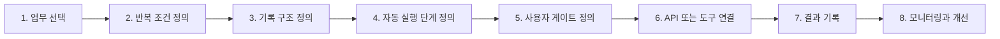
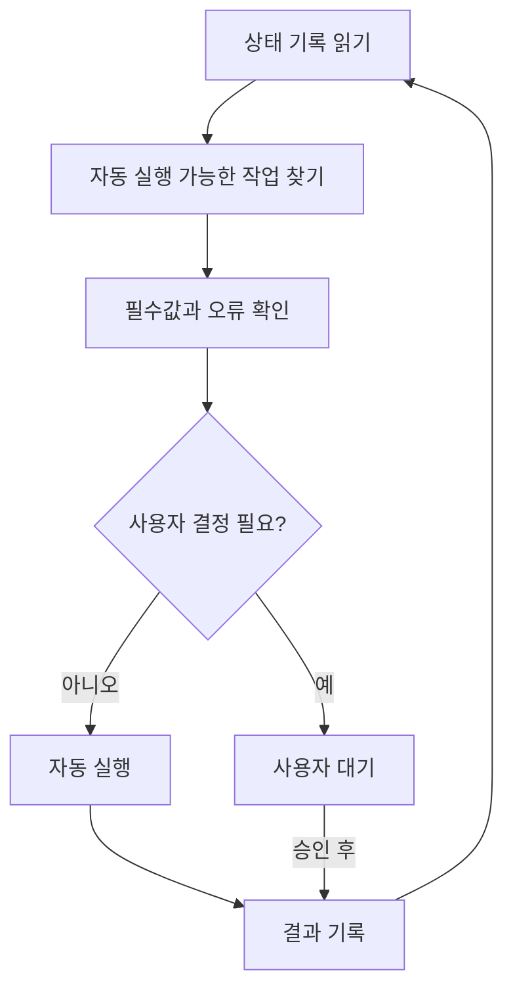
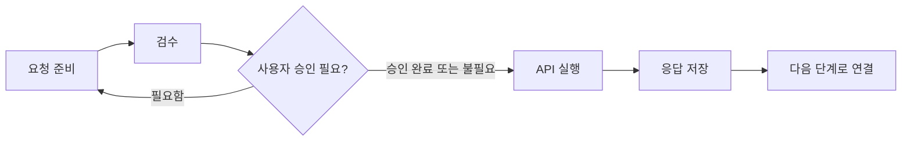

# 추가 자동화 구축 가이드

대상: 이미지나 영상 제작이 아니더라도 새로운 자동화를 추가하려는 사람  
목적: 어떤 업무를 자동화하려면 무엇을 먼저 정하고, 어떤 기록과 승인 구조를 만들어야 하는지 설명합니다.

## 1. 자동화로 만들 수 있는 업무

자동화는 특정 분야에 묶이지 않습니다. 아래 조건을 만족하면 이미지, 영상, 문서, 리포트, 고객 응대, 데이터 정리, 게시 관리 같은 업무도 자동화할 수 있습니다.

자동화하기 좋은 업무:

- 같은 절차가 반복됩니다.
- 입력과 결과가 구분됩니다.
- 중간에 사람이 결정해야 하는 지점이 있습니다.
- API, 데이터, 문서, 메시지, 표, 파일 같은 실행 대상이 있습니다.
- 결과를 다시 기록해야 다음 작업이 이어집니다.

자동화하기 어려운 업무:

- 매번 판단 기준이 완전히 바뀝니다.
- 성공과 실패를 기록할 수 없습니다.
- 사용자가 어디서 승인해야 하는지 정해져 있지 않습니다.
- 외부 실행이 필요한데 권한, 토큰, 비용 기준이 없습니다.

## 2. 추가 자동화 전체 플로우

새 자동화는 아래 순서로 설계합니다.



핵심은 “자동화가 계속 실행할 부분”과 “사용자가 결정해야 멈추는 부분”을 처음부터 나누는 것입니다.

## 3. 플로우별 설명

### 1. 업무 선택

먼저 자동화하려는 업무를 한 문장으로 정의합니다.

좋은 정의:

```text
매일 들어오는 고객 문의를 분류하고, 답변 초안을 만든 뒤, 사용자가 승인한 답변만 발송한다.
```

나쁜 정의:

```text
고객 업무를 자동화한다.
```

정해야 하는 것:

- 어떤 업무를 자동화할지
- 언제 시작되는지
- 무엇을 입력으로 받는지
- 무엇을 결과로 남기는지
- 사용자가 어디서 승인하는지

간단한 기록 예시:

```yaml
automation_name: customer_reply_assistant
goal: "고객 문의를 분류하고 답변 초안을 준비한다"
trigger: "새 문의가 들어왔을 때"
input: "고객 문의 내용"
output: "답변 초안과 처리 상태"
user_gate: "답변 발송 승인"
```

### 2. 반복 조건 정의

자동화는 반복 조건이 있어야 안정적으로 돌아갑니다.

정해야 하는 것:

- 얼마나 자주 실행되는지
- 어떤 조건에서 시작되는지
- 어떤 조건이면 멈추는지
- 어떤 조건이면 사용자에게 묻는지

예시:

| 자동화 유형 | 시작 조건 | 멈춤 조건 |
| --- | --- | --- |
| 문의 분류 | 새 문의가 들어옴 | 카테고리가 불명확함 |
| 리포트 생성 | 매주 월요일 오전 | 데이터가 부족함 |
| 데이터 정리 | 새 데이터가 추가됨 | 중복 기준이 애매함 |
| 게시 준비 | 최종 자산이 승인됨 | 공개 승인이 없음 |
| 비용 작업 | 유료 API가 필요함 | 사용자 승인이 없음 |

### 3. 기록 구조 정의

자동화는 말로 기억하면 안 되고, 구조화된 기록을 읽고 움직여야 합니다.

최소 기록:

| 기록 | 역할 |
| --- | --- |
| 상태 기록 | 지금 어디까지 진행됐는지 알려줍니다. |
| 입력 기록 | 자동화가 처리할 원본 정보를 담습니다. |
| 작업 기록 | 자동화가 무엇을 했는지 남깁니다. |
| 승인 기록 | 사용자가 무엇을 승인했는지 남깁니다. |
| 결과 기록 | 최종 결과와 다음 행동을 남깁니다. |

상태 기록 예시:

```json
{
  "automation_id": "customer_reply_assistant",
  "status": "waiting_for_user",
  "current_step": "draft_ready",
  "next_action": "user_review_reply"
}
```

승인 기록 예시:

```yaml
approval_gate: send_reply
status: waiting_for_user
requires_user_approval: true
approved_scope: null
```

### 4. 자동 실행 단계 정의

자동화가 사람에게 묻지 않고 처리할 수 있는 일을 정합니다.

예시:

- 새 입력을 찾습니다.
- 내용을 분류합니다.
- 누락된 필드를 확인합니다.
- 초안을 만듭니다.
- 중복 여부를 확인합니다.
- 위험하거나 애매한 항목을 표시합니다.
- 결과를 저장합니다.

자동화 루프:



### 5. 사용자 게이트 정의

사용자는 매번 개입하지 않습니다. 자동화가 멈춰야 하는 지점만 정하면 됩니다.

사용자 게이트가 필요한 경우:

- 돈이 나갑니다.
- 외부로 발송, 게시, 업로드됩니다.
- 고객이나 파트너에게 메시지가 전달됩니다.
- 되돌리기 어려운 데이터 변경이 발생합니다.
- 창작 방향이나 비즈니스 판단이 바뀝니다.
- 자동화가 확신하지 못하는 항목이 있습니다.

게이트 예시:

| 게이트 | 사용자가 결정하는 것 |
| --- | --- |
| 발송 승인 | 이 답변을 고객에게 보낼지 결정합니다. |
| 게시 승인 | 이 콘텐츠를 외부에 공개할지 결정합니다. |
| 비용 승인 | 유료 API나 유료 작업을 실행할지 결정합니다. |
| 데이터 변경 승인 | 기존 데이터를 수정하거나 덮어쓸지 결정합니다. |
| 예외 처리 승인 | 자동화가 판단하지 못한 항목을 어떻게 처리할지 결정합니다. |

### 6. API 또는 도구 연결

자동화가 외부 API나 내부 도구를 실행해야 한다면, 연결 전에 세 가지를 정해야 합니다.

정해야 하는 것:

- 무엇을 보낼지
- 무엇을 받을지
- 실행 전 사용자 승인이 필요한지

API 연결 흐름:



API 실행 기록 예시:

```json
{
  "job_id": "api_job_001",
  "tool": "email_sender",
  "status": "ready_for_api",
  "input_set": "approved_reply_001",
  "requires_user_approval": true
}
```

보안 규칙:

- API 키와 토큰은 기록에 넣지 않습니다.
- 로그에 비밀값을 남기지 않습니다.
- 승인된 범위 밖의 요청은 실행하지 않습니다.
- 실패한 요청은 원인과 다음 행동을 기록합니다.

### 7. 결과 기록

자동화는 실행하고 끝나면 안 됩니다. 결과를 남겨야 다음 자동화가 이어집니다.

결과 기록에 들어갈 것:

- 어떤 작업이 실행됐는지
- 어떤 입력을 사용했는지
- 어떤 결과가 나왔는지
- 성공했는지 실패했는지
- 다음 행동이 무엇인지

결과 기록 예시:

```yaml
result_id: result_001
automation_id: customer_reply_assistant
status: completed
input_id: inquiry_001
output_id: reply_001
next_action: "wait_for_new_inquiry"
```

### 8. 모니터링과 개선

자동화가 제대로 작동하는지 보려면 운영 지표가 필요합니다.

볼 지표:

- 자동 처리된 건수
- 사용자 승인이 필요했던 건수
- 실패한 건수
- 재시도한 건수
- 사람이 직접 수정한 비율
- 처리 시간
- 비용 발생 횟수

개선 기준:

- 사용자가 자주 고치는 부분은 자동화 규칙을 수정합니다.
- 실패가 반복되는 조건은 게이트를 추가합니다.
- 승인 없이 실행하면 위험한 작업은 반드시 사용자 게이트로 올립니다.
- 필요 없는 사용자 확인이 많으면 자동 진행 조건을 넓힙니다.

## 4. 자동화 패턴 예시

이미지나 영상이 아니어도 아래 패턴으로 확장할 수 있습니다.

| 자동화 패턴 | 예시 업무 | 핵심 게이트 |
| --- | --- | --- |
| 분류형 자동화 | 문의, 문서, 데이터 행을 카테고리로 나눔 | 분류가 애매할 때 사용자 확인 |
| 초안 생성 자동화 | 이메일, 리포트, 게시글, 제안서 초안 작성 | 외부 발송 또는 공개 전 승인 |
| 동기화 자동화 | 두 시스템의 데이터를 맞춤 | 기존 데이터 변경 전 승인 |
| 모니터링 자동화 | 지표, 상태, 오류를 주기적으로 확인 | 이상 상황 발생 시 사용자 확인 |
| 실행형 자동화 | API 호출, 예약, 업로드, 발송 실행 | 비용, 공개, 외부 전송 전 승인 |
| 요약형 자동화 | 긴 문서나 회의 내용을 짧게 정리 | 중요한 결정 기록 전 승인 |

## 5. 새 자동화 요청서 템플릿

새 자동화를 만들 때는 아래 질문에 답하면 됩니다.

```yaml
automation_name:
goal:
trigger:
input_records:
automatic_steps:
user_gates:
api_or_tool_connections:
output_records:
failure_rules:
monitoring_metrics:
```

예시:

```yaml
automation_name: weekly_report_builder
goal: "매주 주요 지표를 모아 리포트 초안을 만든다"
trigger: "매주 월요일 오전"
input_records:
  - "지난주 지표"
  - "중요 이벤트"
automatic_steps:
  - "데이터 수집"
  - "전주 대비 변화 계산"
  - "리포트 초안 작성"
user_gates:
  - "리포트 발송 승인"
api_or_tool_connections:
  - "데이터 조회 도구"
  - "문서 생성 도구"
output_records:
  - "리포트 초안"
  - "발송 상태"
failure_rules:
  - "데이터가 없으면 사용자에게 확인 요청"
monitoring_metrics:
  - "자동 생성 성공률"
  - "사용자 수정률"
```

## 6. 반드시 지켜야 할 규칙

- 자동화는 사용자 결정을 대신하지 않습니다.
- 비용이 발생하는 작업은 승인 전 실행하지 않습니다.
- 외부 발송, 게시, 업로드, 데이터 변경은 승인 전 실행하지 않습니다.
- API 키, 토큰, 비밀값은 기록이나 로그에 남기지 않습니다.
- 실패하면 조용히 넘어가지 않고 원인과 다음 행동을 기록합니다.
- 자동화는 결과를 남겨야 하며, 결과가 없으면 다음 단계로 넘어가지 않습니다.
