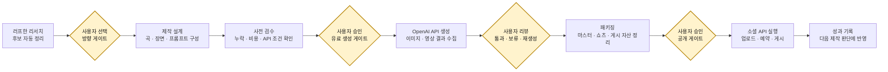
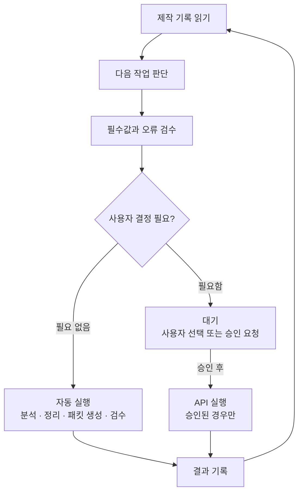
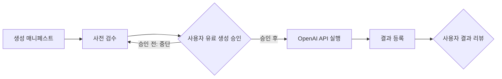
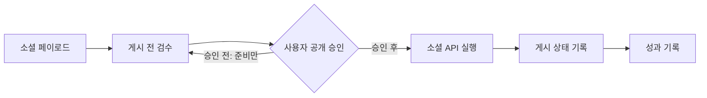

# AI 제작 자동화 운영 설계서

대상: AI 제작 자동화를 이해하거나 비슷한 구조를 구축하려는 사람  
공개 범위: 내부 단계명, 내부 저장 위치, 실제 비밀값, 세부 프롬프트 전문은 제외합니다.

## 1. 핵심 요약

이 자동화는 사용자가 매번 개입하는 시스템이 아닙니다.

자동화는 가능한 작업을 계속 진행하고, 아래처럼 **결정이 필요한 게이트**에서만 사용자에게 멈춰 묻습니다.

```text
기록을 읽는다
-> 자동으로 할 수 있는 작업은 진행한다
-> 승인이나 선택이 필요하면 사용자에게 묻고 멈춘다
-> 승인된 작업만 API로 실행한다
-> 결과를 다시 기록한다
-> 다음 자동 작업으로 이어간다
```

사용자 개입은 “모든 단계”가 아니라 “중요한 결정 지점”에만 발생합니다.

## 2. 전체 플로우



이 그림에서 노란 게이트만 사용자가 결정하는 구간입니다. 나머지는 제작 기록이 충분하면 자동화가 이어서 처리할 수 있습니다.

## 3. 자동화가 실제로 도는 방식



즉, 자동화 엔진은 매번 같은 질문을 합니다.

```text
지금 상태에서 자동으로 할 수 있는가?
할 수 있으면 실행한다.
사용자 결정이 필요하면 멈춘다.
결과가 나오면 기록한다.
```

## 4. 플로우별 동작

### 1. 러프한 리서치

자동화는 트렌드, 음악 방향, 비주얼 무드, 레퍼런스 후보를 모아 몇 개의 제작 루트로 압축합니다.

자동 진행:

- 후보 방향을 수집하고 요약합니다.
- 각 후보의 장점, 리스크, 추천 이유를 정리합니다.
- 사용자가 고를 수 있는 선택지 형태로 만듭니다.

사용자 개입:

- 후보 중 진행할 방향을 고를 때만 개입합니다.

남기는 기록:

```yaml
record_type: research_candidates
status: waiting_for_user
candidates:
  - id: route_001
    idea: "강한 비트와 자신감 있는 퍼포먼스"
    why_it_matters: "짧은 영상에서 첫인상이 강함"
  - id: route_002
    idea: "몽환적인 보컬과 영화적인 장면"
    why_it_matters: "브랜드 이미지 확장에 유리함"
```

### 2. 방향 선택

사용자가 선택한 루트는 이후 모든 제작 단계의 기준이 됩니다.

자동 진행:

- 선택된 방향을 메시지, 곡 방향, 비주얼 세계, 목표 산출물로 정리합니다.
- 이후 단계가 기준을 벗어나지 않도록 방향 기록을 만듭니다.

사용자 개입:

- 최종 방향을 선택하거나 수정할 때 개입합니다.
- 반드시 지킬 요소와 제외할 요소를 승인합니다.

남기는 기록:

```yaml
record_type: direction_lock
status: approved
message: "압박 속에서도 자신감을 유지하는 감정"
sound_direction: "강한 리듬과 낮은 긴장감"
visual_world: "차갑고 선명한 야간 공간"
must_keep:
  - "첫 장면에서 강한 인상"
  - "퍼포먼스가 음악 박자와 맞아야 함"
avoid:
  - "추상적인 분위기만 있는 장면"
```

### 3. 제작 설계

자동화는 선택된 방향을 실제로 만들 수 있는 장면과 프롬프트 구조로 바꿉니다.

자동 진행:

- 곡의 구간, 가사 cue, 에너지 변화를 정리합니다.
- 장면별로 누가 보이고, 어디에서, 어떤 행동을 하는지 설계합니다.
- 스토리보드와 프롬프트 패킷 초안을 만듭니다.

사용자 개입:

- 모든 장면마다 개입하지 않습니다.
- 핵심 장면, 방향이 바뀌는 장면, 생성 비용이 큰 장면만 리뷰할 수 있습니다.

남기는 기록:

```yaml
record_type: scene_plan
status: ready_for_prompting
scene_id: scene_004
music_cue: "후렴 첫 비트"
visible_action: "메인 퍼포머가 앞으로 걸어오며 카메라를 본다"
camera: "비스듬한 정면 앵글에서 천천히 가까워짐"
```

### 4. 생성 준비

자동화는 승인된 설계를 API가 실행할 수 있는 요청 묶음으로 바꿉니다.

자동 진행:

- 장면을 프롬프트 패킷으로 변환합니다.
- 생성 요청 수와 필요한 입력을 확인합니다.
- 누락, 형식 오류, 비용 발생 여부를 검수합니다.

사용자 개입:

- 유료 생성이 필요한 경우에만 승인 게이트가 열립니다.

남기는 기록:

```yaml
record_type: prompt_packet
status: ready_for_review
packet_id: prompt_004
subject: "메인 퍼포머"
setting: "밤의 유리 복도"
action: "비트에 맞춰 앞으로 걸어오며 카메라를 응시"
output_type: image
```

생성 매니페스트 예시:

```json
{
  "record_type": "generation_manifest",
  "status": "waiting_for_user",
  "provider": "openai",
  "request_count": 12,
  "input_set": "approved_prompt_set_001",
  "approval_gate": "paid_generation"
}
```

### 5. API 생성

사용자가 승인한 생성 요청만 OpenAI API 같은 생성 API로 보냅니다.

자동 진행:

- 승인된 요청만 API에 제출합니다.
- 작업 상태를 추적합니다.
- 돌아온 결과를 생성 자산으로 등록합니다.

사용자 개입:

- API 실행 전 유료 생성 범위를 승인합니다.
- 결과가 돌아온 뒤 통과, 보류, 재생성을 결정합니다.

API 흐름:



결과 기록 예시:

```yaml
record_type: generation_result
status: waiting_for_user
asset_set: generated_image_set_001
source_manifest: generation_manifest_001
review_options:
  - pass
  - hold
  - regenerate
```

### 6. 결과 리뷰

자동화는 생성 결과를 사용자가 판단하기 쉬운 묶음으로 정리합니다.

자동 진행:

- 결과를 장면, 프롬프트, 자산 단위로 연결합니다.
- 통과된 결과만 패키징 후보로 넘깁니다.
- 보류나 재생성 대상은 다시 생성 준비 단계로 되돌립니다.

사용자 개입:

- 결과 묶음을 보고 통과, 보류, 재생성만 결정합니다.
- 개별 내부 기록을 직접 고칠 필요는 없습니다.

남기는 기록:

```yaml
record_type: review_decision
asset_id: image_004_a
decision: pass
next_stage: packaging
```

### 7. 패키징

자동화는 통과된 결과물을 실제 공개 가능한 묶음으로 정리합니다.

자동 진행:

- 마스터 영상, 짧은 버전, 썸네일, 소셜용 클립을 구분합니다.
- 어떤 자산이 어떤 목적에 쓰이는지 결과 레지스트리에 남깁니다.
- 공개 준비 전 상태로 정리합니다.

사용자 개입:

- 최종 공개 패키지를 승인할 때 개입합니다.

결과 레지스트리 예시:

```yaml
record_type: output_registry
status: waiting_for_user
assets:
  master_video: master_video_001
  short_video: short_video_001
  thumbnail: thumbnail_001
release_ready: false
```

### 8. 게시 준비

자동화는 공개 승인 전에 게시 문구와 플랫폼별 payload를 준비합니다.

자동 진행:

- 플랫폼별 게시 문구와 미디어 자산을 연결합니다.
- 예약 또는 게시 가능한 상태인지 검수합니다.
- 승인 전에는 실제 업로드나 예약을 하지 않습니다.

사용자 개입:

- 공개할 플랫폼, 자산, 문구, 실행 시점을 승인할 때 개입합니다.

소셜 페이로드 예시:

```json
{
  "record_type": "social_payload",
  "status": "waiting_for_user",
  "platform": "instagram_reels",
  "media_asset_id": "short_video_001",
  "caption": "새 퍼포먼스 비디오가 공개됩니다."
}
```

### 9. 게시 및 성과 기록

사용자가 승인한 게시 요청만 소셜 미디어 API로 실행됩니다.

자동 진행:

- 승인된 게시 요청을 업로드, 예약, 게시 중 하나로 실행합니다.
- 게시 ID와 게시 상태를 기록합니다.
- 이후 성과 지표를 기록합니다.

사용자 개입:

- 게시 실행 전에 승인합니다.
- 성과를 다음 제작 방향에 반영할지 결정할 때 개입합니다.

소셜 API 흐름:



성과 기록 예시:

```json
{
  "record_type": "social_metrics",
  "platform": "instagram_reels",
  "post_id": "post_001",
  "views": 12000,
  "engagement": 640
}
```

## 5. 사용자 개입 지점만 따로 정리

사용자는 아래 지점에서만 필수로 개입합니다.

| 게이트 | 사용자가 결정하는 것 |
| --- | --- |
| 방향 게이트 | 어떤 리서치 후보를 실제 제작 방향으로 갈지 선택합니다. |
| 유료 생성 게이트 | OpenAI API 같은 생성 API를 실행할 범위와 비용 발생을 승인합니다. |
| 결과 리뷰 게이트 | 생성 결과를 통과, 보류, 재생성 중 하나로 결정합니다. |
| 공개 게이트 | 어떤 자산을 어느 플랫폼에 업로드, 예약, 게시할지 승인합니다. |
| 성과 반영 게이트 | 게시 성과를 다음 제작 방향에 반영할지 결정합니다. |

나머지 정리, 검수, 패킷 생성, 상태 업데이트, 결과 연결은 자동화가 처리할 수 있습니다.

## 6. 자동화 구축에 필요한 최소 구성

| 구성 요소 | 역할 |
| --- | --- |
| 제작 기록 저장소 | 상태, 방향, 장면, 프롬프트, 결과, 게시 정보를 저장합니다. |
| 자동화 엔진 | 현재 상태를 읽고 다음 작업을 판단합니다. |
| 검수기 | 필수값 누락, 형식 오류, 승인 필요 여부를 확인합니다. |
| 승인 게이트 | 사용자 선택이나 승인이 필요한 지점에서 자동화를 멈춥니다. |
| 생성 API 커넥터 | 승인된 생성 요청만 OpenAI API 같은 생성 API로 보냅니다. |
| 소셜 API 커넥터 | 승인된 게시 요청만 소셜 미디어 API로 보냅니다. |
| 결과 등록기 | 생성 결과, 게시 상태, 성과 지표를 제작 기록으로 되돌립니다. |

## 7. 기본 상태값

```yaml
draft: "초안"
waiting_for_user: "사용자 결정 대기"
approved: "사용자 승인 완료"
ready_for_api: "API 실행 준비 완료"
submitted: "API 요청 제출 완료"
generated: "생성 결과 도착"
reviewed: "사용자 리뷰 완료"
packaged: "패키징 완료"
published: "게시 또는 예약 완료"
blocked: "누락, 오류, 승인 부족으로 중단"
```

## 8. 반드시 지켜야 할 규칙

- 사용자가 승인하지 않은 유료 생성은 실행하지 않습니다.
- 사용자가 승인하지 않은 업로드, 예약, 게시도 실행하지 않습니다.
- API 키, 플랫폼 토큰, 비공개 설정은 제작 기록에 넣지 않습니다.
- 생성 결과는 사용자 리뷰를 통과해야 다음 단계로 넘어갑니다.
- 게시 성과는 실제 플랫폼 데이터 또는 사용자가 확인한 값만 기록합니다.
- 자동화는 창작 결정을 대신하지 않고, 준비와 실행 관리를 돕습니다.
